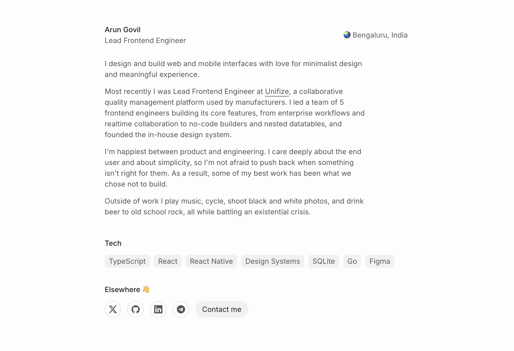

## Preview



## Made with

- Next.js (static export)
- Tailwind CSS
- Markdown posts, highlighted at build time with highlight.js

## Running locally

```sh
yarn install
yarn dev
```

## Content

- Work: `content/Work.ts`
- Projects: `content/Projects.ts`
- Posts: Markdown files in `posts/` (put cover images in `public/img/posts/`)
- About: `components/About.tsx`

## Deploying

Pushes to `main` build and publish the site to GitHub Pages through
`.github/workflows/deploy.yml`.

- The repo is named `arungovil.github.io`, so the site is served from the root URL.
- In the repo, set Settings > Pages > Source to **GitHub Actions**.
- To build the static site locally, run `yarn export` (output goes to `out/`).
